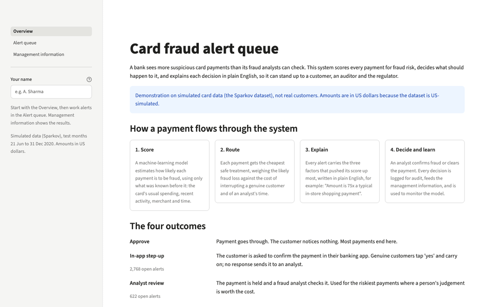
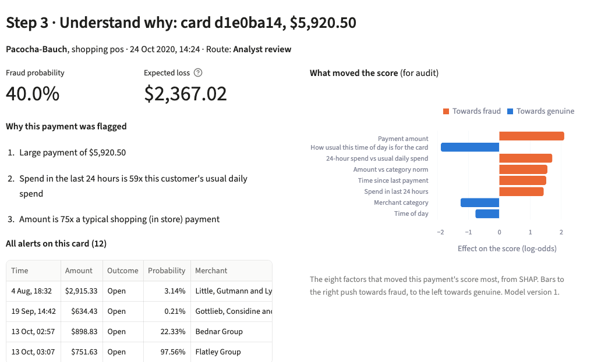
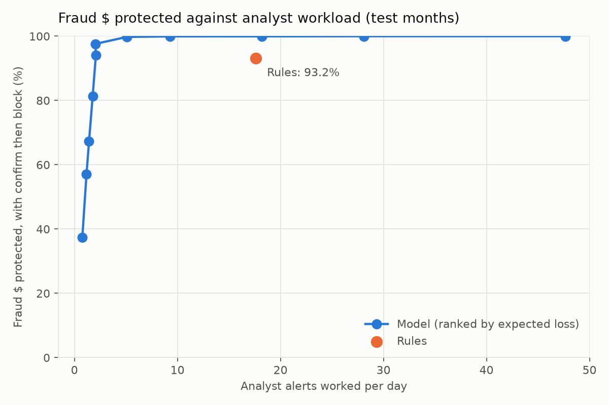

# Explainable card-fraud alert queue

A fraud operations team gets more alerts than its analysts can work. **Which alerts should an analyst see first, and can each one be explained to a customer, an auditor and the regulator?**

This project answers that end to end: a SQL feature layer in dbt, an XGBoost model that is checked hard for leakage, a cost-based routing decision, three plain-English reasons on every alert, and a Streamlit queue where analysts record decisions with a full audit trail. The BA pack (process maps, user stories, traceability, UAT, a model card on PRA SS1/23) sits alongside it.

> **Simulated data.** Everything runs on the Kaggle Sparkov dataset: 1.85 million card payments on 999 US cards, 2019 and 2020. The simulator makes fraud much easier to spot than a real book does, so the results show the method and the controls. They are not a forecast of production performance. Money is in US dollars because the data is US-simulated.



## The story in two minutes

**Today (as-is).** Rules flag payments. Analysts work them in arrival order with only a rule name to go on. Three in four rules alerts are genuine customers whose card has just been declined, and a fifth of fraud value never raises an alert at all: mostly $100 to $499 grocery payments that no rule describes.

**After (to-be).** Every payment gets a fraud probability built only from what was known before it happened. Each one then takes its cheapest expected action, given analyst capacity and the cost assumptions: approve, ask the customer to confirm in their banking app, hold for an analyst, or decline and block the card. Analysts work the highest expected loss (probability x amount) first.

**What changes for the analyst.** Each alert says why it was flagged, using the payment's own numbers:



**What it is worth.** At the rules' own workload of about 21 analyst alerts a day:

| Approach | Precision (hit rate) | Recall | PR-AUC | Fraud value caught | Total cost, test months |
|---|---|---|---|---|---|
| Rules (A2, B2) | 24.8% | 47.0% | n/a | 80.6% | $94,596 |
| Logistic regression | 36.7% | 69.4% | 0.574 | 85.9% | $144,706 |
| **XGBoost (champion)** | **52.1%** | **98.6%** | **0.974** | **99.8%** | **$7,033** |

Test months 21 Jun to 31 Dec 2020 (555,719 payments, 2,145 frauds), used once. Total cost is fraud losses plus analyst time, with a confirmed fraud blocking the card after one hour. Logistic regression costs more than the rules despite better precision: its alerts reach fewer of the compromised cards, so fewer cards get blocked before the next fraud. Full table: [docs/results_table.md](docs/results_table.md).

The model also needs far fewer analysts for the same protection. It reaches about 98% of fraud value with roughly two alerts a day; the rules need about 18 a day to reach 93%.



Against the rules, the four-route policy saves about $155k a year on this book, and the saving stays positive under every assumption in the sensitivity analysis (lowest case $85k). See [docs/business_case.md](docs/business_case.md).

## Why the numbers are believed

A PR-AUC of 0.974 is treated as a bug until explained. The checks ([docs/test_cases.md](docs/test_cases.md), TC-19 to TC-22):

- Shuffled labels give ROC-AUC 0.46, so no hidden label is reaching the model.
- A model given only amount, category and hour, with no history at all, already scores ROC-AUC 0.9975. The simulator makes fraud easy to separate; that is the honest reason the numbers are high.
- Training and testing are split by time. Features are SQL window functions over each card's *earlier* payments only, and a planted leak is caught by a dbt test.

## Controls a bank would ask about

| Concern | What is in place |
|---|---|
| Card data (PCI DSS) | Card numbers exist only in the raw table. dbt staging replaces them with a keyed HMAC-SHA256 token; the key lives in `.env` |
| Personal data (UK GDPR) | Name, address, date of birth and gender never reach the features. Age and gender sit in a restricted schema used only for the fairness audit |
| Fair treatment (Consumer Duty, Equality Act) | Interruption and detection rates by age band and gender with confidence intervals. No group is flagged; one watch item (genuine women interrupted at 62 against 50 per 10,000 for men) is explained and monitored |
| Model risk (PRA SS1/23) | Model card, decision log of every design choice, MLflow run history and registry, monthly drift and outcome monitoring with red/amber/green thresholds |
| Audit trail | Every decision records who, when, the score shown, the route and the model version, in an append-only log |
| Automated decisions (Article 22) | Every automatic decline is reviewed by an analyst, who can reinstate the customer |

## How it is built

```
Kaggle CSVs ──> PostgreSQL raw table ──> dbt: staging (tokenised, minimised)
                                             ├─> features (window functions, CTEs)
                                             ├─> rules baseline
                                             └─> restricted fairness attributes
features ──> train (2019) ──> compare (Jan to Jun 2020) ──> retrain ──> test once
         ──> MLflow registry (fraud-xgboost@champion)
scores ──> cost-based routing ──> SHAP reasons ──> app.alerts ──> Streamlit queue and MI
                                                              └─> monthly drift monitoring
```

PostgreSQL 16, dbt-postgres, Python 3.11 (pandas, scikit-learn, XGBoost, SHAP), MLflow, Streamlit, Docker Compose, pytest and ruff, GitHub Actions.

## How to run it

You need Docker Desktop, Python 3.11 and about 2 GB of disk for the data.

**1. Get the data.** Download the Kaggle dataset [Credit Card Transactions Fraud Detection](https://www.kaggle.com/datasets/kartik2112/fraud-detection) (a free Kaggle account is needed) and put `fraudTrain.csv` and `fraudTest.csv` in `data/raw/`. The data is never committed.

**2. Settings.** Copy the example and set a database password and a card-token key (`openssl rand -hex 32`):

```bash
cp .env.example .env
```

**3. Start the services** (PostgreSQL, MLflow and the app):

```bash
docker compose up -d
```

**4. Python environment:**

```bash
python3.11 -m venv .venv && .venv/bin/pip install -r requirements-dev.txt
```

**5. Run the pipeline**, in this order. Load the settings into the shell first:

```bash
set -a && . ./.env && set +a
```

```bash
.venv/bin/python src/load_data.py
```

```bash
cd dbt && ../.venv/bin/dbt build --profiles-dir . && cd ..
```

```bash
for step in train final_model decisioning explain fairness drift results_table; do .venv/bin/python src/$step.py || break; done
```

| Step | What it does |
|---|---|
| `load_data.py` | Loads both CSVs into the raw table |
| `dbt build` | Builds staging, features, rules and the restricted table, and runs the dbt tests |
| `train.py` | Fits on 2019, compares settings on Jan to Jun 2020, logs every run to MLflow |
| `final_model.py` | Retrains the chosen settings on all training months, scores the test months once, registers the champion |
| `decisioning.py` | Calibration, routing policies, capacity curve, sensitivity analysis |
| `explain.py` | SHAP reasons and the alerts table the app reads |
| `fairness.py` | Fairness audit by age band and gender |
| `drift.py` | Monthly drift, outcome and fairness monitoring |
| `results_table.py` | The results table above |

Optional: `src/leakage_checks.py` reruns the leakage diagnostics and `src/spot_check_features.py` rechecks the SQL features against pandas.

**6. Open it.**
- Analyst app: http://localhost:8501 (start on the Overview page)
- MLflow: http://localhost:5001

**Tests:** with the settings loaded, `.venv/bin/pytest` runs the unit tests and rebuilds the SQL features on a small hand-checked fixture in a separate `fraud_ci` database. `.venv/bin/ruff check .` runs the linter. GitHub Actions runs both on every push.

## Documents

| Document | For |
|---|---|
| [Problem statement](docs/problem_statement.md) | The business problem, scope and success measures |
| [Stakeholders](docs/stakeholders.md) | Who is affected, RACI |
| [User stories and requirements](docs/user_stories.md) | US-01 to US-15, functional and non-functional requirements |
| [Process maps](docs/process_maps.md) | As-is and to-be, with pain points and gains |
| [Traceability matrix](docs/traceability_matrix.md) | Requirement to story to test to evidence |
| [UAT script](docs/uat_script.md) | Ten scenarios for a fraud analyst, with the dry run and the defect it found |
| [Test cases](docs/test_cases.md) | Every check run during the build |
| [Results table](docs/results_table.md) | Rules against models at the same workload |
| [Business case](docs/business_case.md) | Cost comparison, sensitivity analysis, recommendation |
| [Fairness audit](docs/fairness_audit.md) | Age band and gender, rules against model |
| [Model card](docs/model_card.md) | Structured on PRA SS1/23 |
| [Monitoring](docs/monitoring.md) | Drift, outcome and fairness thresholds, with a runbook |
| [Data dictionary](docs/data_dictionary.md) | Every column, generated from dbt, with the lineage graph |
| [Decision log](docs/decision_log.md) | Every design decision, the alternatives and who made it |

## Limitations

- Simulated, highly separable data; a real book would give much lower precision and recall.
- A small book: 999 cards, about 2,900 payments a day.
- Fraud labels here are complete and immediate. Real labels arrive 30 to 90 days late.
- Step-up confirm and pass rates are assumptions, not measurements.
- Batch scoring of a historical period, not real time.
- Analysts type their name; production would need login and role-based access.

## Author

Amrit Sharma: business analyst, MSc Business Analytics (Durham University), 15 months in card-fraud operations. The process design, the routing tiers and the scope decisions come from that operations work. Built with Claude Code as an AI pair programmer; who decided what is recorded in the [decision log](docs/decision_log.md).
<!-- D34: LinkedIn link to be added by Amrit -->

Licence: [MIT](LICENSE), for the code only. The Kaggle dataset is not redistributed here; download it from Kaggle under its own terms.
