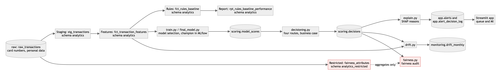

# Data dictionary

Generated from dbt's manifest by `docs/process/data_docs.py`; every column below is documented in the dbt YAML next to its model. Card numbers and personal data exist only in the raw table; `analytics_restricted` holds age band and gender for the fairness audit only.

dbt runs 38 data tests on these models (see `dbt/models/*/_*.yml` and `dbt/tests/`).

## analytics.stg_transactions

One row per transaction with the card number replaced by a keyed token and personal data removed. Every downstream model reads from here, never from the raw table.

| Column | Type | Description |
|---|---|---|
| `trans_num` | text | Unique transaction ID. |
| `trans_ts` | timestamp without time zone | Date and time of the payment. |
| `card_token` | text | HMAC-SHA256 of the card number. Stable per card, not reversible without the key. |
| `merchant` | text | Merchant name as supplied (simulated). |
| `category` | text | Merchant category, for example grocery_pos (in store) or shopping_net (online). |
| `amt` | numeric(12,2) | Payment amount in US dollars (the dataset is US-simulated). |
| `distance_km` | numeric | Haversine distance from the customer's home to the merchant. |
| `is_fraud` | smallint | Label. Used as the training target only, never as a feature. |
| `source_file` | text | Source file: fraudTrain.csv (Jan 2019 to 21 Jun 2020) or fraudTest.csv (21 Jun to Dec 2020). |

## analytics_restricted.fairness_attributes

RESTRICTED. Age band (at the time of payment) and gender per transaction, used only by the fairness audit (src/fairness.py), which outputs aggregates only. Lives in its own schema so it is never read by features, models or the analyst app.

| Column | Type | Description |
|---|---|---|
| `trans_num` | text | Unique transaction ID. |
| `age_band` | text | Customer's age band on the payment date. |
| `gender` | character(1) | Gender as recorded in the source data (F or M). |

## analytics.fct_transaction_features

Model features, one row per transaction, using only information available before that transaction. Read by training, scoring and the alert queue.

| Column | Type | Description |
|---|---|---|
| `trans_num` | text | Unique transaction ID. |
| `trans_ts` | timestamp without time zone | Date and time of the payment. |
| `card_token` | text | Card token from staging (no card number). |
| `merchant` | text | Merchant name; used for the new-merchant feature and shown to analysts. |
| `source_file` | text | Source file, used to split training and test months. |
| `amt` | numeric(12,2) | Payment amount in US dollars. A model input. |
| `category` | text | Merchant category. A model input (one-hot encoded). |
| `hour_of_day` | integer | Hour of the payment, 0 to 23. A model input. |
| `txn_count_1h` | bigint | Card's transactions in the hour before this one. |
| `txn_count_24h` | bigint | Card's transactions in the 24 hours before this one. |
| `amt_sum_24h` | numeric | Card's spend in the 24 hours before this one. |
| `prior_txn_count` | bigint | Number of earlier transactions on this card. Tells the model how much history the ratios rest on. |
| `prior_avg_amt` | numeric | Card's average amount over all earlier payments (helper for amt_vs_avg; not a model input). |
| `amt_vs_avg` | numeric | This amount divided by the card's average over all earlier transactions. Null on a card's first transaction. |
| `distance_km` | numeric | Distance from the customer's home to the merchant, in km. |
| `is_new_merchant` | integer | 1 if this card has not been used at this merchant before. |
| `secs_since_last` | bigint | Seconds since this card's previous transaction. Null on a card's first. |
| `amt_vs_category_avg` | numeric | This amount divided by the average of all earlier payments in the same category, across all cards. |
| `is_new_category` | integer | 1 if this card has not been used in this category before. |
| `hour_band_share` | numeric | Share of the card's earlier payments in the same 4-hour time-of-day band. Low means an unusual hour for this customer. |
| `small_txn_count_24h` | bigint | Payments under $20 on this card in the previous 24 hours (card testing). |
| `spend_24h_vs_daily_avg` | numeric | (Previous 24h spend + this amount) divided by the card's average daily spend so far. |
| `is_fraud` | smallint | Label. Training target only, never a feature. |

## analytics.rpt_rules_baseline_performance

Rules baseline volumes, hit rate, recall and fraud value caught, by period and route.

| Column | Type | Description |
|---|---|---|
| `period` | text | Training or test months. |
| `rules_route` | text | Treatment given by the rules. |
| `payments` | bigint | Payments on this route. |
| `per_day` | numeric | Payments a day on this route. |
| `frauds` | bigint | Fraud payments on this route. |
| `precision_pct` | numeric | Share of routed payments that were fraud (hit rate). |
| `recall_pct` | numeric | Share of all fraud in the period that this route caught. |
| `fraud_value_usd` | numeric | Fraud dollars on this route. |
| `value_caught_pct` | numeric | Share of all fraud dollars in the period that this route caught. |

## analytics.fct_rules_baseline

Analyst-style rules baseline, one row per transaction. Flags each rule and routes the payment to analyst review, in-app step-up or approve (stronger treatment wins).

| Column | Type | Description |
|---|---|---|
| `trans_num` | text | Unique transaction ID. |
| `trans_ts` | timestamp without time zone | Date and time of the payment. |
| `card_token` | text | Card token from staging. |
| `source_file` | text | Source file (training or test months). |
| `amt` | numeric(12,2) | Payment amount in US dollars. |
| `is_fraud` | smallint | Label, for measuring the rules only. |
| `rule_a2_unusual_amount` | boolean | A2 fired: amount at least 10x the card's earlier average. |
| `rule_b2_night_high_value` | boolean | B2 fired: between 22:00 and 04:00 and at least $500. |
| `rule_d1_new_merchant_high_value` | boolean | D1 fired: first payment at this merchant and at least $500. |
| `rules_route` | text | Treatment the rules give the payment: analyst_review, step_up or approve. |
| `rules_fired` | text | Plain-English list of the rules that fired, for the analyst and the audit trail. |
