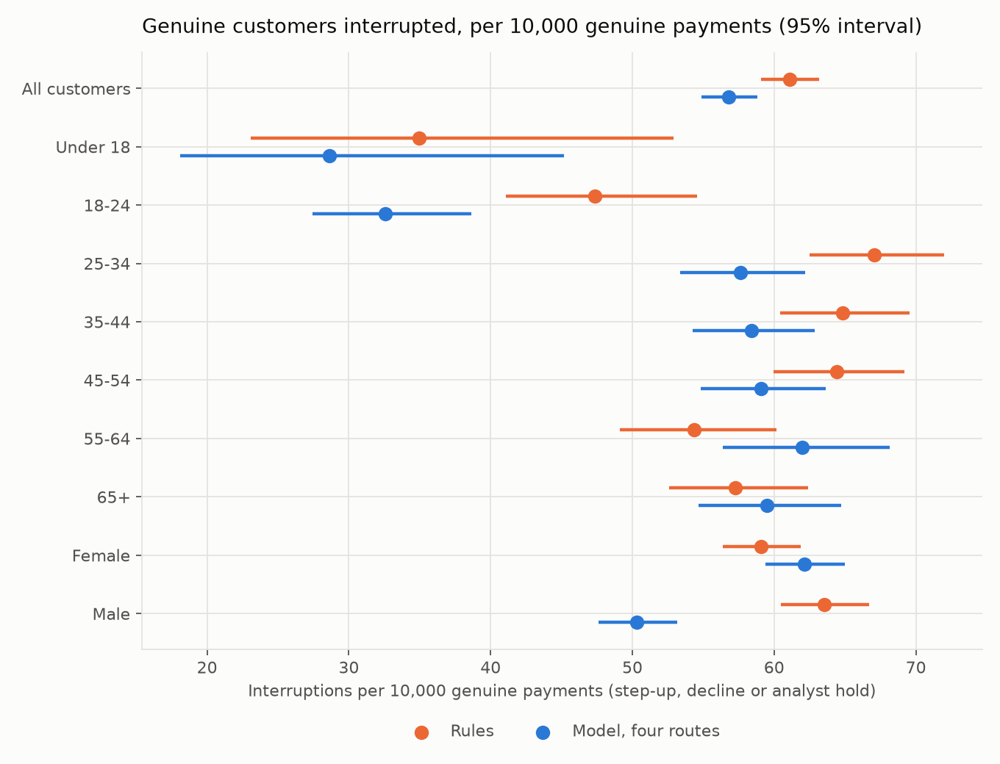

# Fairness audit

**Status:** draft for review. Produced by `src/fairness.py` on the test months (21 Jun to 31 Dec 2020). Full tables are logged in the MLflow experiment `fairness`.

## Why this audit exists

Under the FCA's **Consumer Duty**, a firm must show its processes deliver good outcomes for all groups of customers, and the **Equality Act 2010** prohibits indirect discrimination on protected characteristics such as age and sex. A fraud model can be unfair without ever seeing age or gender, if other features act as proxies for them.

Two questions, asked for the current rules and for the model's four-route policy:

1. **Customer harm:** are genuine customers in some groups interrupted (stepped up, declined, or held for an analyst) more often than others?
2. **Protection:** is any group left less protected from fraud?

## Method

- **Groups:** age band at the time of payment, and gender. These come from a restricted dbt model (`analytics_restricted.fairness_attributes`) holding only the transaction ID, age band and gender. It is never read by features, models or the analyst app. This script outputs aggregates only.
- **Measures:** interruptions per 10,000 genuine payments, and the share of fraud payments and fraud value detected, each with a 95% Wilson interval so small groups are not over-read.
- **Flag rule** (material *and* statistically clear):
  - interruptions: a group's lower 95% bound is above 1.25 times the overall rate
  - protection: a group's upper 95% bound is below 0.8 times the overall detection rate

## Results

| Group | Rules: interruptions per 10k genuine | Model: interruptions per 10k genuine | Rules: fraud detected | Model: fraud detected |
|---|---|---|---|---|
| All customers | 61.1 | **56.8** | 47.9% | **97.9%** |
| Under 18 | 35.0 | 28.6 | (no fraud) | (no fraud) |
| 18-24 | 47.3 | 32.6 | 56.9% | 99.3% |
| 25-34 | 67.1 | 57.6 | 46.1% | 98.8% |
| 35-44 | 64.8 | 58.4 | 43.3% | 97.7% |
| 45-54 | 64.4 | 59.1 | 44.0% | 97.0% |
| 55-64 | 54.4 | 62.0 | 54.6% | 98.5% |
| 65+ | 57.3 | 59.5 | 49.2% | 97.3% |
| Female | 59.1 | 62.1 | **42.3%** | 97.3% |
| Male | 63.5 | 50.3 | **54.5%** | 98.8% |

**No group is flagged under either policy.**

## Findings

1. **The model interrupts fewer genuine customers overall** (56.8 against 61.1 per 10,000) **and detects fraud far more evenly.** Under the rules, women's fraud was detected noticeably less often than men's (42% against 55%, a protection gap the rules never surfaced). The model closes it (97% against 99%).

2. **Watch item: the model interrupts genuine women more often than genuine men** (62.1 against 50.3 per 10,000). The intervals don't overlap, so it is a real difference, but at 1.09 times the overall rate it is below the flag threshold. Under the rules the pattern ran the other way (59.1 against 63.5).
   - **It is not explained by what people buy.** If women had men's interruption rate within each merchant category, their rate would be 51.7, not 62.1. Most of the gap sits within categories (miscellaneous in-store 111 against 63; home 61 against 41).
   - **Likely driver: the "amount vs category norm" feature.** It compares each payment with the average across all customers. Women's genuine payments are more often three or more times the category norm (4.4% against 3.7%), so a feature built on a population-wide norm acts partly as a proxy.
   - **Recommendation:** keep it under monitoring, and test a challenger that compares each payment with the customer's *own* category history. That was the alternative considered when the feature was designed, and it is likely to be fairer.

3. **Age:** 55-64 and 65+ are interrupted slightly more under the model than the rules (62.0 and 59.5 against 54.4 and 57.3), within the overall range and below the flag threshold. Younger customers are interrupted less.

4. **Data quality: 13 cards belong to customers aged 13 to 17**, a simulator artefact (UK credit cards require 18 or over). They are reported as their own band rather than hidden in 18-24.

## Limitations

- Simulated data: group differences reflect how the simulator generated customers and fraud, so these results test the **method**, not a real customer base.
- Gender is recorded as two values in the source data; a real audit would need to handle other and unrecorded genders.
- The audit covers who is interrupted, not how the interruption is handled. Analyst conduct, step-up accessibility (for example, customers without a smartphone) and complaint outcomes would also need checking under Consumer Duty.

## Ongoing monitoring (proposed)

Re-run this audit monthly alongside the drift report, and escalate to the model owner if any group is flagged, or if the female/male interruption gap widens beyond 1.25 times.
