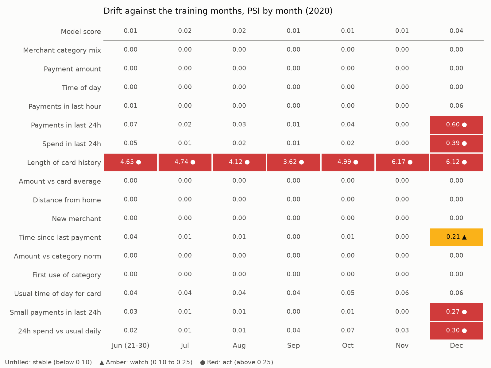

# Model monitoring

**Status:** draft for review. Produced by `src/drift.py` over the test months (21 Jun to 31 Dec 2020), which stand in for the first six months after go-live. Results are in `monitoring.drift_monthly` and the MLflow experiment `monitoring`.

## Why monitor

A fraud model is trained on the past. Customers' spending changes, fraudsters change tactics, and the model's inputs can shift underneath it. PRA SS1/23 (principle 5) expects ongoing monitoring with set thresholds and a clear owner, so a problem is caught by the bank and not by its losses or its complaints.

## What is checked each month

| Check | Question it answers | Measure | Green / amber / red |
|---|---|---|---|
| Input drift | Do this month's payments look like the ones the model learned from? | Population Stability Index (PSI) for the payment amount, each of the 14 engineered features and the merchant-category mix, against the training months | below 0.10 / 0.10 to 0.25 / above 0.25 |
| Seasonal comparison | Is a flagged feature just the time of year? | PSI against the same calendar month a year earlier, for any amber or red feature | below 0.10 means seasonal |
| Score drift | Is the model scoring payments differently? | PSI of the fraud probability against the model's scores on its training months | as input drift |
| Outcomes | Is the queue still stopping fraud? | Share of fraud value stopped by the routes; alerts a day by route; analyst hit rate; genuine customers interrupted per 10,000 | Fraud value: amber more than 2 points below the test-period baseline, red more than 5 |
| Fairness | Is the fairness audit's watch item getting worse? | Each gender's interruption rate against the month's overall rate | amber at 1.10x; red when the lower 95% bound is above 1.25x (the audit's flag rule) |

PSI in one line: it splits a feature into ten bands using the training data, then measures how far this month's spread across those bands has moved. Zero means identical; above 0.25 is the usual "investigate" level.

## Results

**The model's output is stable and it is still doing its job.** The score's PSI stays between 0.01 and 0.04 every month (green), and the routes stop at least 99.8% of fraud value in every month.

Three things were flagged:

1. **December: five "last 24 hours" features go red** (payments in last 24h 0.60, spend in last 24h 0.39, 24h spend vs usual daily 0.30, small payments 0.27; time since last payment amber at 0.21). This is Christmas shopping: payments per day double in December. Against December 2019 every one of these scores 0.000 to 0.003, so the change is seasonal, not a change in customers.
   - **What it does to operations:** in December the analyst hit rate falls to 16% (21% to 36% in the other months) and step-ups rise to 22 a day (12 to 17). Busier cards look more unusual, so the model asks more genuine customers to confirm payments.
   - **Action:** no retrain. Plan December staffing and step-up capacity in advance, and have the model owner confirm each year that December matches the previous December.

2. **"Length of card history" is red every month** (PSI 3.6 to 6.2). This is built into the feature, not a change in customers: it counts a card's earlier payments, so it only ever grows. The median card had 777 earlier payments in the training months and 2,139 in the test months, beyond most of what the model saw in training.
   - **Why it hasn't hurt yet:** the feature carries 3.5% of the model's explanation (SHAP), and its useful signal is at the low end (new cards), which is still in range.
   - **Action:** raise with the model owner. A challenger should replace the raw count with a capped or banded version (for example new, under 50, 50 or more) that cannot drift by construction. No change now: the scope is frozen, and the score and outcomes are stable.
   - **Lesson for feature design:** any running count needs a cap before it goes into a model.

3. **Fairness watch item: amber in June and December.** Women's interruption rate was 1.13x and 1.17x the overall rate in those months (1.06x to 1.08x otherwise), below the 1.25x red line. It moves with the busy periods, which fits the fairness audit's finding that the population-wide "amount vs category norm" feature drives the gap.
   - **Action:** keep monthly; it supports the customer-specific category norm challenger already recommended in `fairness_audit.md`.

## What happens when something goes red (runbook)

| Step | Who | What |
|---|---|---|
| 1 | Model owner (fraud analytics) | Check whether the red is seasonal (same month last year) or a data fault (pipeline, a merchant category mapping, a feed outage) |
| 2 | Model owner | If it's neither, check outcomes: fraud value stopped, hit rate, interruptions. A red input with stable outcomes goes on watch for one more month |
| 3 | Model owner and model risk (second line) | Two months of red on any of the top five SHAP features, or a red on outcomes, triggers retraining and revalidation before the new version goes live |
| 4 | Fraud operations lead | Interim mitigation if outcomes are red: lower the analyst-review threshold within capacity, or fall back to the rules baseline (kept running in dbt for this reason) |
| 5 | Model owner | Record the finding and the decision in the decision log |

Retraining is deliberately not automatic. Under SS1/23 a materially changed model needs validation before use, and a retrain can also bring back problems (for example in fairness) that the current version passed.

## Limitations

- **Label delay:** outcome checks here use the dataset's complete fraud labels. In live use, fraud is often confirmed 30 to 90 days later through chargebacks and customer claims, so outcome checks for a month are provisional until about three months later. Input and score drift have no delay, which is why they are the early warning.
- **Simulated data:** the Sparkov simulator produces very stable behaviour apart from seasonality, so this shows the method working, not how often a real book drifts.
- **Score baseline:** the model's scores on its own training months are slightly more confident than on new data. That makes score drift a little conservative (it flags slightly earlier), which is the safe direction.
