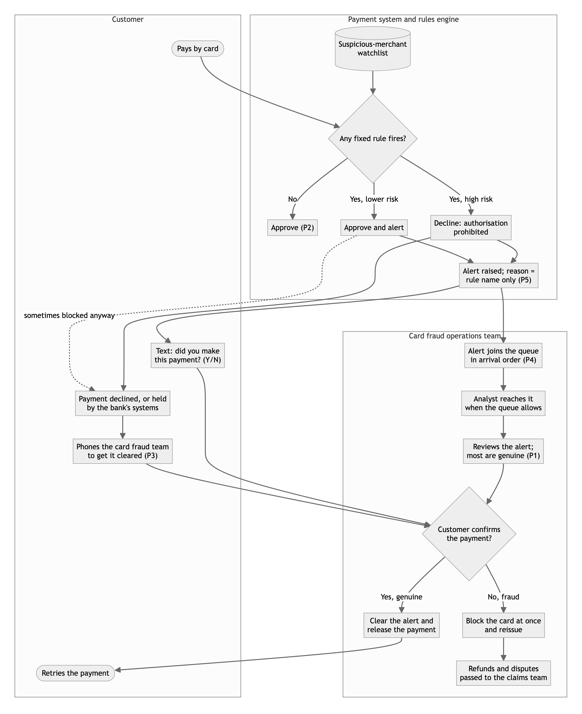
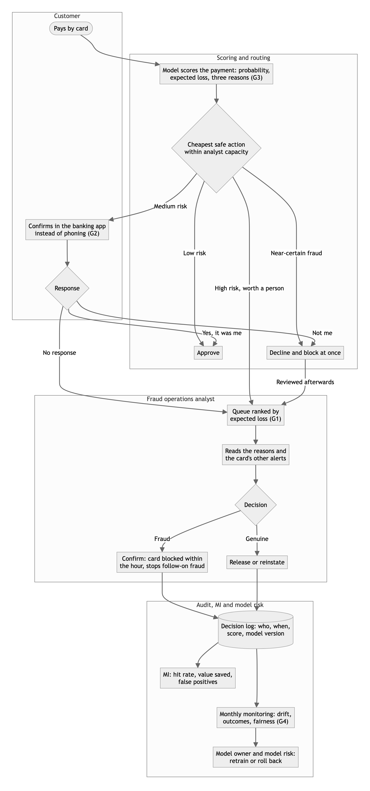

# Process maps: as-is and to-be

Sources are in `docs/process/*.mmd` (Mermaid, which GitHub also renders), exported to PNG with `docs/process/render.py`.

## As-is: rules, a first-come queue and a phone call

The as-is map is a **typical UK card-issuer process**, drawn from operations experience in card fraud. It is generic and contains nothing specific to any one bank.

| Marker | Pain point | Evidence (test months, simulated data) |
|---|---|---|
| P1 | Most of the analyst's work is on genuine customers | 3 in 4 rules alerts are genuine (hit rate 24.8%) |
| P2 | Fraud that no rule describes goes straight through | 19% of fraud value is never alerted; mostly $100 to $499 in-store grocery payments |
| P3 | A genuine customer has to phone the bank to get a declined payment released | Every genuine rules alert is a customer whose payment failed |
| P4 | The queue order ignores how much money is at risk | A $50 alert can sit ahead of a $5,000 one |
| P5 | The only explanation is the rule's name | Nothing a customer or auditor can be given about this payment |

## To-be: score, route by cost, explain, decide, learn

| Marker | Gain | Evidence |
|---|---|---|
| G1 | The analyst's hour goes to the most money at risk | At the same 21 alerts a day, hit rate rises from 24.8% to 52.1% and fraud value caught from 80.6% to 99.8% (`results_table.md`) |
| G2 | Genuine customers confirm in their banking app instead of phoning | Medium-risk payments go to in-app step-up; only non-responders reach an analyst |
| G3 | Every alert carries three plain-English reasons | 100% of 5,129 alerts; reasons tested for direction and wording |
| G4 | The model is watched, not trusted blindly | Monthly drift, outcome and fairness checks with an owner and a runbook (`monitoring.md`) |

## What changes for each role

| Role | Today | After |
|---|---|---|
| Customer | Declined at the till, phones the bank | Taps "yes, it was me" in the app; most never notice anything |
| Fraud analyst | Works alerts in arrival order with a rule name | Works the highest expected loss first, with three reasons and the card's other alerts |
| Team leader | Volume and backlog | MI on hit rate, value saved and false positives; capacity curve for staffing |
| Model owner and model risk | Rules tuned by hand, rarely reviewed | Monthly monitoring with thresholds; retraining is a governed decision |
| Audit | Rule name and outcome | Who decided, when, on what score, with which model version |
